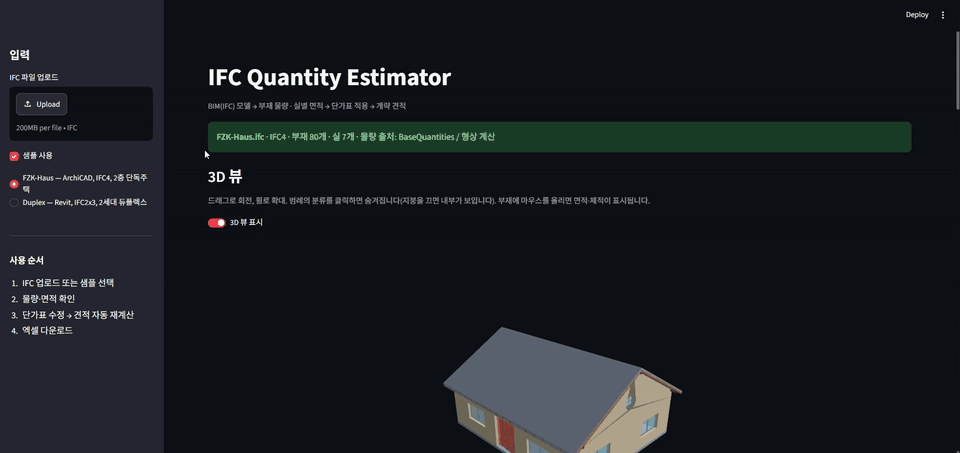

# IFC Quantity Estimator

BIM 모델(IFC)을 넣으면 부재별 물량표와 실별 면적표를 뽑고, 단가표를 곱해 개략 견적까지 산출하는 도구입니다.

설계 데이터가 이미 BIM에 있는데도 물량 산출과 견적은 사람이 다시 손으로 옮기는 경우가 많습니다. 이 프로젝트는 그 사이를 코드로 잇는 작은 실험입니다. 모듈러·프리패브처럼 표준화된 주택일수록 BIM 물량을 그대로 견적에 쓸 여지가 크다고 보고 시작했습니다.

## 현재 상태

| 단계 | 내용 | 상태 |
|---|---|---|
| 1 | IFC 파싱 → 부재별 물량(개수·면적·체적) CSV | 완료 |
| 2 | 실별 면적표(㎡·평), 층 정보 | 완료 |
| 3 | 단가표 × 물량 → 공종별 견적·총액·평당가 | 완료 |
| 4 | 웹 화면(업로드 → 표 → 단가 수정 → 엑셀 다운로드) | 완료 |
| 5 | 배포 (Streamlit Community Cloud) | 완료 |
| 6 | 3D 뷰어 — 분류별 켜고 끄기, 부재 hover 시 면적·체적 | 완료 |
| 7 | 수량 정보가 없는 부재의 형상 기반 체적 계산 | 진행 중 |

## 데모

**Live demo:** https://ifc-quantity-estimator.streamlit.app



## 실행

```bash
python -m venv .venv
.venv\Scripts\activate        # Windows
pip install -r requirements.txt

streamlit run app.py                    # 웹 화면
python extract.py samples/FZK-Haus.ifc  # 물량만 CSV로
python estimate.py samples/FZK-Haus.ifc # 물량 + 견적 → output/estimate.xlsx
```

## 구조

```
app.py            Streamlit 화면 — 업로드 · 3D 뷰 · 표 · 단가 편집 · 차트 · 엑셀 다운로드
extract.py        IFC → 부재별 물량 / 실별 면적 (ifcopenshell)
estimate.py       물량 × 단가표 → 공종별 견적 · 총액 · 평당가 · 엑셀
viewer.py         IFC 형상 → 삼각 메시 → plotly Mesh3d
data/unit_prices.csv   단가표 = 산출 규칙표 (항목·산출기준·단가)
samples/FZK-Haus.ifc   테스트용 IFC4 주택 모델
```

단가표의 `산출기준` 열("벽체 면적", "문 개수" 등)이 코드의 계산 규칙과 연결됩니다. 단가를 바꾸거나 항목을 추가해도 코드 수정 없이 반영되도록 했습니다.

## 샘플 결과 (AC20-FZK-Haus, 2층 단독주택)

부재 요약

| 분류 | 개수 | 면적 합계(㎡) | 체적 합계(㎥) |
|---|---|---|---|
| 벽체 | 13 | 190.46 | 54.479 |
| 바닥/지붕 슬래브 | 4 | 384.96 | 76.991 |
| 창호 | 11 | 23.17 | – |
| 문 | 5 | 12.14 | – |
| 구조 부재(서까래 등) | 42 | – | – |

실별 면적

| 실명 | 층 | 순면적(㎡) | 평 |
|---|---|---|---|
| 거실 | 1층 | 25.21 | 7.63 |
| 침실 | 1층 | 21.41 | 6.48 |
| 주방 | 1층 | 16.31 | 4.93 |
| 서재 | 1층 | 12.60 | 3.81 |
| 욕실 | 1층 | 12.13 | 3.67 |
| 복도 | 1층 | 11.19 | 3.38 |
| 다락/갤러리 | 2층 | 74.51 | 22.54 |

연면적(순) 173.36㎡ = 52.44평

## 견적 샘플 (단가는 전부 가정값)

| 공종 | 금액(원) | 비중 |
|---|---|---|
| 구조 | 86,020,300 | 56.6% |
| 내부마감 | 48,540,800 | 32.0% |
| 창호 | 15,060,500 | 9.9% |
| 문 | 2,250,000 | 1.5% |
| **합계** | **151,871,600** | 평당 2,896,025원 |

## 어떻게 동작하나

### 물량 (extract.py)

- **물량은 IFC에 내장된 `BaseQuantities`를 읽습니다.** 설계 툴(이 샘플은 ArchiCAD)이 내보낸 값을 그대로 쓰므로 형상 재계산 없이 빠르고, 설계자가 보는 수치와 일치합니다.
- 면적 기준은 부재마다 다릅니다. 벽은 측면적(`NetSideArea`), 슬래브는 평면적(`NetArea`), 창호·문은 개구부 면적(`Area`)을 씁니다.
- 실(`IfcSpace`)은 층에 `ContainedIn`이 아니라 `Aggregates` 관계로 묶여 있어 층을 따로 추적합니다.
- 재료는 `IfcMaterialLayerSet`을 풀어 층별 재료명을 이어 붙입니다.

### 3D 뷰 (viewer.py)

화면의 집 모양은 이 프로젝트가 만든 것이 아니라, **IFC 파일 안에 부재별로 저장된 형상 정의를 그대로 계산해 그린 것**입니다.

1. **IFC에 들어 있는 것** — IFC는 텍스트 파일이고, 벽·창·지붕 같은 부재마다 형상 정의가 붙어 있습니다. 대부분은 돌출체(`IfcExtrudedAreaSolid`: "이 2D 단면을 이 방향으로 이만큼 밀어라")이고, 창호·계단처럼 복잡한 것은 경계면 집합(BRep)으로 저장돼 있습니다. 벽에 뚫린 창 구멍은 `IfcOpeningElement`로 별도 기록됩니다. 각 부재의 위치·방향은 `IfcLocalPlacement`가 층 → 건물 → 대지 순으로 계층적으로 정의합니다.
   `samples/FZK-Haus.ifc`를 텍스트 편집기로 열어 `IFCEXTRUDEDAREASOLID`를 검색하면 벽체 단면과 돌출 높이가 그대로 보입니다.
2. **형상 → 메시** — `ifcopenshell.geom.iterator`가 위 정의를 삼각형 메시(꼭짓점 좌표 + 삼각형 인덱스)로 변환합니다. 내부에서 CAD 커널(OpenCASCADE)이 돌출과 불리언 연산(벽에서 개구부 빼기)을 실제로 수행합니다. `use-world-coords` 옵션으로 모든 부재를 전역 좌표로 받습니다.
3. **메시 → 화면** — 부재의 `GlobalId`로 물량표와 짝을 맞춰 분류(벽체·창호·슬래브…)별로 메시를 묶고 색을 입혀 plotly `Mesh3d`로 그립니다. 마우스를 올리면 나오는 면적·체적은 1단계 물량표의 값입니다. 범례 클릭으로 분류를 숨길 수 있어, 지붕 슬래브를 끄면 내부 벽 배치가 보입니다.

물량(수량값 읽기)과 3D(형상 계산)는 **서로 독립적인 두 경로**입니다. 그래서 수량값이 빠진 부재는 형상 메시에서 체적을 직접 계산해 채울 수 있고, 이것이 다음 단계(7)입니다.

처음 열 때 형상 변환에 10초 안팎이 걸리며, 이후엔 캐시됩니다.

## 한계

- 수량 정보가 없는 부재(이 샘플의 서까래·보 일부)는 면적·체적이 0으로 나옵니다. 형상에서 직접 계산하는 폴백은 아직 없습니다.
- 샘플은 경량콘크리트 주택입니다. 단가표의 값은 목조 주택을 가정한 임의값이라 실제 견적 근거로 쓸 수 없습니다.
- 실명·층명 한글 변환은 샘플 기준 매핑이라 다른 파일은 원문 그대로 나옵니다.

## 스택

Python 3.10 · ifcopenshell 0.9.0 (OpenCASCADE 기반 형상 변환) · pandas · numpy · Streamlit 1.65 · plotly · openpyxl

## 샘플 출처

[AC20-FZK-Haus.ifc](https://github.com/ThatOpen/engine_web-ifc/blob/main/tests/ifcfiles/public/AC20-FZK-Haus.ifc) — KIT(카를스루에 공과대학) 공개 테스트 모델, IFC4
